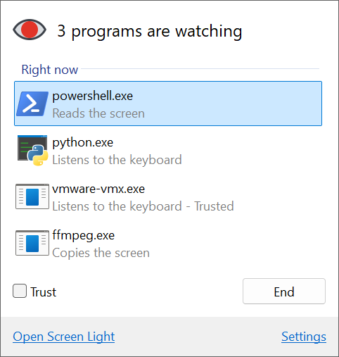
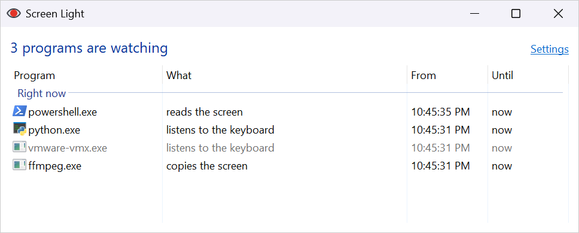
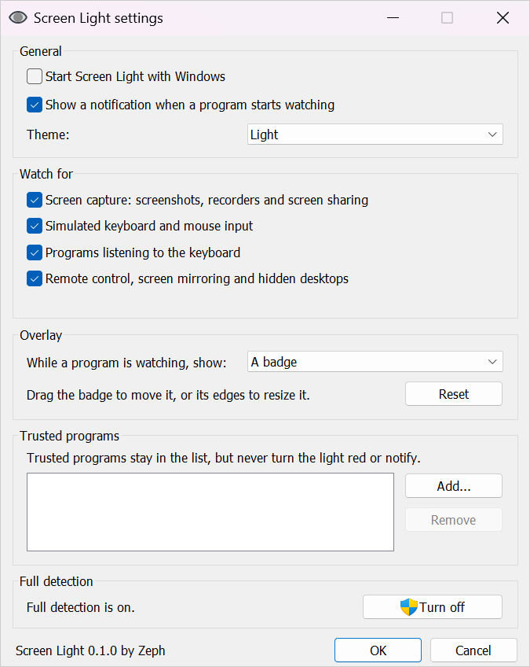

<p>
  
</p>

# Screen Light

Windows shows an icon when an app uses your microphone, but it doesn't properly tell you who's watching your screen
or your keyboard. So I made Screen Light. It puts an eye in your system tray that turns red when a program records
your screen, takes screenshots, reads your keys or clicks and types on its own, and it tells you which program it is.

<p align="center">
  <picture>
    <source media="(prefers-color-scheme: dark)" srcset="docs/panel-dark.png">
    
  </picture>
</p>

## Features

- Shows which program is recording or sharing your screen, or taking screenshots.
- Catches keyloggers and other programs reading your keyboard.
- Notices when a program types, clicks or moves the mouse by itself.
- Spots remote control, screen mirroring and programs hiding on a desktop you can't see.
- Also lists what could watch you, like a keyboard driver that isn't from Microsoft or an overlay in your game.
- Lets you know when something starts watching, with a notification or a badge on screen.
- End a program right from the list, or trust the ones you know.
- Doesn't connect to the internet and never records your keys or your screen.
- Works on 64-bit Windows 7 to 11 and barely uses any CPU or RAM.

## Download

Get the installer or the portable zip from the [Releases](../../releases/latest) page.

The exe isn't signed yet, so SmartScreen will warn you the first time. Click More info, then Run anyway.

## Is it safe?

It never connects to the internet, and it doesn't save or send anything you type or anything on your screen. To
notice programs typing on their own, it only checks whether a key press came from a keyboard or from a program, never
which key it was. Full detection adds a background service because Windows only shares screenshot and keylogger
events with programs running as admin.

## Usage

- Install it, and say yes when it asks to turn on full detection. Screenshots and keyloggers can't be seen without it.
- The eye in your system tray turns red when something is watching. Click it to see what, or double-click it for the
  full list.
- Select a program to end it, or tick Trust if it's something you know, like a chat app's push-to-talk key.
- Right-click the eye for the settings.

<p align="center">
  <picture>
    <source media="(prefers-color-scheme: dark)" srcset="docs/window-dark.png">
    
  </picture>
</p>

You can also have a badge on screen while something is watching. Drag it anywhere, and pull its edges to make it
bigger or smaller.

<p align="center">
  <picture>
    <source media="(prefers-color-scheme: dark)" srcset="docs/badge-dark.png">
    
  </picture>
</p>

<p align="center">
  <picture>
    <source media="(prefers-color-scheme: dark)" srcset="docs/settings-dark.png">
    
  </picture>
</p>

## Current limitations

- It only sees what Windows sees, so hardware like a capture card, a camera pointed at your screen or a USB keylogger
  can't be caught.
- It notices new drivers, but can't see what a driver does once it's running.
- Programs that read other windows the way screen readers do aren't shown.
- Keyloggers are only caught on Windows 10 version 1809 or newer.
- On Windows 7, screenshots are only caught with Aero turned on.

## Building

You need Python 3 and the msvcrt x86_64 build of [llvm-mingw](https://github.com/mstorsjo/llvm-mingw). Set
`SCREENLIGHT_MINGW` to where you unpacked it, then run:

```bash
python build.py
```

That gives you `out/ScreenLight.exe`. `python release.py` also makes the installer and the portable zip. It needs
[Inno Setup](https://jrsoftware.org/isinfo.php), so set `SCREENLIGHT_ISCC` to its `ISCC.exe`.

## License

GPL 3.0, see [LICENSE](LICENSE).
